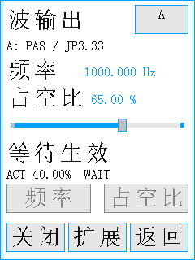
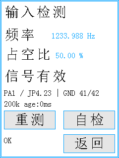
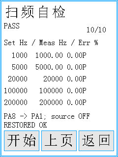
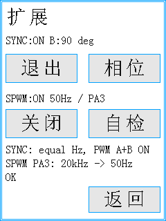
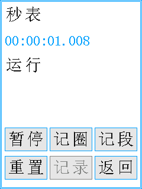
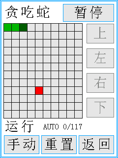

# STM32F407ZGT6 触摸屏多功能信号实验平台

基于 **STM32F407ZGT6 + ILI9341 电阻触摸屏**，使用 **CubeMX、STM32 HAL 和 CMake** 构建。一个固件集成双路 PWM、输入捕获、自动扫频自检、同步相位、SPWM、秒表和贪吃蛇，所有操作通过 240×320 竖屏中文菜单完成。

[固件下载](https://github.com/Warr1v/lab2_f407/releases/latest) · [屏幕操作](App/Screen/README.md) · [验证记录](docs/VALIDATION.md) · [版本记录](CHANGELOG.md)

仓库包含 `.ioc`、HAL/CMSIS 驱动、启动文件、1 MiB Flash 链接脚本和 CMake 配置，安装工具链后即可编译，无需重新生成 CubeMX 工程。默认上电 **A、B、SPWM 全部关闭**。

## 功能

| 模块 | 功能 |
| --- | --- |
| PWM 输出 | A/B 独立频率与占空比；标准 1 Hz～200 kHz、1% 占空比步进；扩展 1 Hz～500 kHz、5% 步进；支持 0%/100% 恒定电平 |
| 触摸交互 | 中文菜单、数字键盘、主波输出页实时占空比滑动条；识别按下/拖动/抬起，数值跟手，松手保留最终值 |
| 输入检测 | 1 Hz～200 kHz（扩展至 500 kHz）；TIM5 + 双 DMA 边沿采集；显示频率、占空比及有效性；无信号、超范围和错误自动处理 |
| 双路同步 | 同频 PWM 同步；B 相对 A 滞后 0～360°，5° 步进 |
| SPWM | PA3 输出 20 kHz 载波、400 点/周期、50 Hz 正弦调制；支持独立启停 |
| 扫频自检 | 10 Hz～200 kHz 十频点，实际回读比对，分页显示设定/实测/误差；支持取消及恢复原输出状态 |
| 秒表 | 开始、暂停、继续、复位、记圈/记段，最近六条记录；切页继续计时 |
| 贪吃蛇 | 手动/自动模式、方向控制、暂停/继续、重置；离页暂停并保留进度 |

以上为软件实现能力。当前版本已构建、烧录，用户已反馈屏幕、基础外部输入和回环可运行；500 kHz 精度、同步相位、滤波后 SPWM、波形抖动及整机并发仍需仪器验收，详见[验证记录](docs/VALIDATION.md)。

## 界面预览

以下为实际 ARM 固件在 LCD/触摸边界模型中的渲染图，展示布局和交互状态，**不是开发板实拍或仪器测量**。

| 实时占空比拖动 | 输入检测 | 扫频结果 |
| :---: | :---: | :---: |
|  |  |  |

| 同步与 SPWM | 秒表 | 贪吃蛇 |
| :---: | :---: | :---: |
|  |  |  |

## 硬件与引脚

适配对象为本项目已验证的 STM32F407ZGT6 学习板及外接并行 ILI9341 模块。MCU 为 LQFP144，内部 Flash **1 MiB**、普通 SRAM **128 KiB**、CCM **64 KiB**；DMA 缓冲放普通 SRAM。

时钟配置：**HSE 8 MHz 晶体 → PLL 8/336/2/7 → SYSCLK 168 MHz**；APB1/APB2 定时器时钟分别为 84/168 MHz。调试使用 Serial Wire，保留 PA13/PA14。

| 信号 | GPIO / 外设 | 本板排针 |
| --- | --- | --- |
| PWM A | PA8 / TIM1_CH1 | JP3.33 |
| PWM B | PC7 / TIM8_CH2 | JP3.38 |
| 输入捕获 | PA1 / TIM5_CH2，内部间接通道捕获下降沿 | JP4.23 |
| SPWM | PA3 / TIM2_CH4 | JP4.25 |
| 地 | GND | JP4.41 / JP4.42 |
| LCD | FSMC NE4=PG12、RS/A6=PF12，16 位数据总线 PD/PE | 外接 TFT 排针 |
| LCD 背光 | PB15 | TFT 模块 |
| 电阻触摸 | PEN=PB1、MISO=PB2、MOSI=PF11、CLK=PB0、CS=PC13 | TFT 模块 |

`JPx.n` 表示连接器针号；接线时核对实物第 1 针方向。当前触摸映射固化在 [screen_touch_profile.h](App/Screen/screen_touch_profile.h)，更换物理面板或方向需要重新标定。

## 编译与烧录

准备 **CMake ≥3.22、Ninja、Arm GNU Toolchain（arm-none-eabi）**，并将可执行文件目录加入 PATH。已验证环境为 CMake 4.3.1、Ninja 1.13.2、Arm GCC 14.3.1；也可使用 VS Code 的 ST 官方 STM32 扩展提供的工具。

```sh
git clone https://github.com/Warr1v/lab2_f407.git
cd lab2_f407
cmake --preset Debug
cmake --build --preset Debug
cmake --preset Release
cmake --build --preset Release
```

输出为 `build/Debug/lab2_f407.elf` 和 `build/Release/lab2_f407.elf`。首次使用推荐 [Release 页面](https://github.com/Warr1v/lab2_f407/releases/latest) 中已上板的 Debug 固件；下载文件和 SHA256 校验表可一起保存。

安装 STM32CubeProgrammer，连接 ST-Link/SWD 后执行（CLI 也需加入 PATH）：

```sh
STM32_Programmer_CLI -c port=SWD freq=4000 -w build/Debug/lab2_f407.elf -v -rst -run
```

使用预编译 `.elf`/`.hex` 时替换文件路径即可；`.bin` 需额外指定起始地址 `0x08000000`。若 ST-Link 被 IDE 调试会话占用，先结束该调试会话再烧录。

业务定时器/DMA 由各模块端口初始化。CubeMX 再生成时保留 USER CODE 和自定义 CMake 接入，避免增加重复的 TIM1/TIM2/TIM5/TIM8 或 DMA 初始化。

## 最快跑通回环

1. 关闭并断开外部信号发生器，用跳线连接 **PA8（JP3.33）→ PA1（JP4.23）**。
2. 进入“波输出”，右上角选 **A**，设 **1000 Hz、50%**，点击“开启”。
3. 返回“输入检测”，应读到约 **1000 Hz、50%**。两个引脚在同一块板上，共用板内地参考。
4. 在波输出主页面按住滑动条左右拖动，占空比目标数字实时变化；`ACT` 显示已应用的计算占空比，`WAIT` 表示等待硬件周期边界。
5. 从输入页“自检”进入，点击“开始”。十点为 **10、20、50、100、500、1000、5000、20000、100000、200000 Hz**，占空比 50%。误差 ≤1% 为单点通过，全部通过且恢复成功才显示总 `PASS`。

结果表中的 `P/F` 为单点判定，`RESTORED` 表示原 A 参数及启停状态已恢复。可翻页、取消、切换菜单；自检运行中手动改 A 被阻止。回环用于验证基本输出—捕获链路，绝对精度仍需独立信号源或示波器确认。

## 其他操作

- **外部输入**：先断开 PA8→PA1 回环，信号接 PA1、地接板 GND，确保实际电压在 0～3.3 V。首测可设方波 1 kHz/50%、3 Vpp、偏置 +1.5 V、High-Z，再用示波器确认引脚电压。恒高/恒低不能测得有效频率。
- **扩展模式**：主菜单“扩展”同时切换输出与输入量程。进入前两路占空比需为 5% 整档，退出前两路频率需 ≤200 kHz；不满足时显示拒绝原因，不自动修改参数。
- **同步与相位**：先使 A/B 同频、均开启正常 PWM，再进入波输出页“扩展→同步”。相位为 B 滞后 A。改频率或关闭通道前先退出同步。
- **SPWM**：进入波输出页“扩展→SPWM”。PA3 是数字调制输出；观察模拟正弦需按 [两级 RC 滤波说明](App/Wave/FILTER.md) 接滤波器。
- **低频拖动**：UI 保留最新目标，不排队回放旧位置；实际波形需等待已接受请求及周期边界，`ACT` 可能晚于滑块变化。
- **示波器抖动**：先使用被测通道边沿触发、合适触发电平和探头倍率。稳定触发后的明显周期/脉宽抖动仍需排查，回环通过不作为抖动合格结论。

## 工程结构

```text
App/Contracts/        统一业务 API
App/Wave/             双路 PWM、同步相位、SPWM
App/Input/            输入采集、DMA 端口、诊断
App/SelfTest/         唯一扫频状态机
App/Screen/           页面、键盘、实时滑动条、触摸映射
App/Mock/             既有 HAL tick 秒表状态（保留目录名）
App/Game/             贪吃蛇逻辑
BSP/Screen/           LCD、触摸、字库及资源工具
Core/                 初始化、时钟、统一中断入口
Drivers/              STM32 HAL / CMSIS
cmake/                Arm 工具链及 CubeMX 配置
tests/                ARM 逻辑、DMA、UI 和回归检查
lab2_f407.ioc          CubeMX 配置
startup_stm32f407xx.s  启动及向量表
STM32F407xx_FLASH.ld   内部 Flash / SRAM / CCM 布局
```

主循环顺序为 Wave → Input → Sweep → 诊断 → Screen。屏幕切页不停止采集，扫频及硬件请求等待不阻塞 UI。正常固件不含命令邮箱或测试替身。

## 软件检查

构建不需要 Python。运行软件模型检查时另备 **Python 3 + PowerShell**：

```powershell
powershell -ExecutionPolicy Bypass -File tests/run_integration_checks.ps1
```

PowerShell 7 可使用 `pwsh -File tests/run_integration_checks.ps1`。脚本在需要时把 `unicorn==2.1.4`、`pyelftools==0.32` 安装到本地 `build/test_python`，构建并检查 Debug、Release、Diagnostic，以及触摸拖动、扫频恢复、游戏、秒表与字体。

原教学资料未包含在仓库中，不影响编译、字库检查或业务模型检查。需要额外核对原始资源哈希时运行：

```sh
python BSP/Screen/tools/verify_assets.py --reference-dir /path/to/original/tftlcd --require-reference
```

测试依赖 Git 历史核对模块来源，推荐完整 `git clone` 后运行。独立测试目标和可选命令邮箱说明见[验证记录](docs/VALIDATION.md)。

## 参考与许可

LCD/触摸驱动由教学例程适配，中文点阵由 Windows SimSun 离线生成；同类功能设计参考 [suanlayu666/EDA_Task2](https://github.com/suanlayu666/EDA_Task2/tree/c0c4af479f2eeeec071a3e2e81a88b5b73179d09)。本项目保留适配本板的时钟、引脚、LCD/触摸初始化与业务实现。

HAL、CMSIS 及其他第三方文件保留各自的许可声明，见 [HAL 许可](Drivers/STM32F4xx_HAL_Driver/LICENSE.txt)、[CMSIS 许可](Drivers/CMSIS/LICENSE.txt)。
